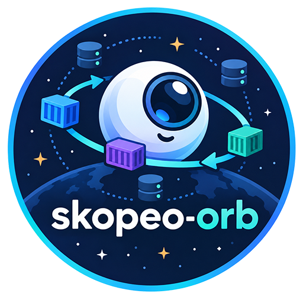
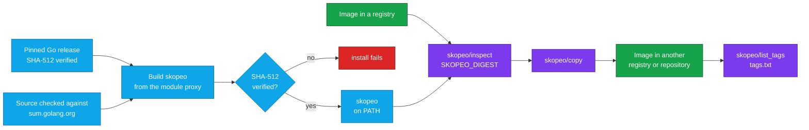

<div align="center">



# Skopeo Orb for CircleCI

### Copy, inspect and list container images across registries, straight from CircleCI.

Install a checksum-verified [skopeo](https://github.com/containers/skopeo) and work with images where they live:<br>
promote a build between registries, mirror a base image, read a tag's digest, or check which tags exist.<br>
No Docker daemon · Built from source, strict SHA-512 verification by default · No `sudo` · Passwords never on the command line

[](https://circleci.com/gh/juburr/skopeo-orb)
[](https://circleci.com/developer/orbs/orb/juburr/skopeo-orb)
[](LICENSE)
[](https://discuss.circleci.com/c/ecosystem/orbs)


**[Quick Start](#-quick-start)** · **[Features](#-why-skopeo-orb)** · **[Recipes](#-recipes)** · **[Commands](#-commands)** · **[Security](#-secure-by-design)** · **[Network Access](#-network-access)**

<sub>An unofficial, community-maintained orb. [Contributions are welcome!](#-contributing)</sub>

</div>

<br>

## ✨ Why skopeo-orb?

<table>
<tr>
<td width="33%" valign="top">
🚚 <b>Registry to registry, no daemon</b><br><br>
<code>copy</code> moves an image between registries, or between a registry and a local OCI layout, directory or archive, with every platform of a multi-platform image by default. It runs on a Docker executor without <code>setup_remote_docker</code>.
</td>
<td width="33%" valign="top">
🔍 <b>Inspect without pulling</b><br><br>
<code>inspect</code> reads an image's platform, layers, labels, manifest or configuration from the registry, saves it as JSON for later steps, and exports the digest the tag points to.
</td>
<td width="33%" valign="top">
🏷️ <b>Tags at a glance</b><br><br>
<code>list_tags</code> writes a repository's tags to a file, one per line, so a later step can check whether a release tag already exists with a plain <code>grep</code>.
</td>
</tr>
<tr>
<td width="33%" valign="top">
🔐 <b>Built from source, verified</b><br><br>
skopeo ships no binaries, so <code>install</code> builds the release with a pinned Go toolchain and installs it only if the binary matches the SHA-512 this orb pins for that release. Versions it can't verify are refused, not built. <a href="#-checksum-verification">Opt-outs</a> are explicit.
</td>
<td width="33%" valign="top">
🔑 <b>Secrets stay off the command line</b><br><br>
Credential parameters name environment variables. The password reaches skopeo on stdin, so it never shows up in a process listing or the step log, even with xtrace on.
</td>
<td width="33%" valign="top">
🦾 <b>amd64 and arm64</b><br><br>
Builds for x86_64 executors and CircleCI Arm resource classes, and caches the verified binary per version and architecture, so only the first job builds it.
</td>
</tr>
</table>

### 🧩 The Orb vs. a Hand-Rolled Script

| | Scripting skopeo yourself | With the orb |
| --- | --- | --- |
| **Installing skopeo** | Use the distribution's package, often several releases behind, or build it: install Go, pick build tags that need no C libraries, and trust whatever comes out | `skopeo/install` builds any release from 1.14.0 on with a pinned, checksum-verified Go, checks the binary against a SHA-512 the orb pins, caches it, and puts it on the `PATH` |
| **Registry login** | Pipe the password to `skopeo login --password-stdin`, find a credentials file a non-root job can write, and keep a traced step from printing the password | `login` reads the variables you name, stores the credentials where skopeo, docker, crane and oras all read them, and does the rest |
| **Copying every platform** | Remember `--multi-arch all` (skopeo's default copies only the runner's platform), then read the digest back from the destination | `copy` copies every platform by default and exports the digest it wrote |
| **Reading a tag's digest** | Run `skopeo inspect --format '{{.Digest}}'`, and inspect again for anything else, hoping the tag didn't move in between | `inspect` exports the digest, and reads the rest of its output for that digest |

## 🔄 How It Works



skopeo publishes source releases only. `skopeo/install` downloads a pinned Go release and checks it against its SHA-512, builds skopeo from the Go module proxy (which checks the source against Go's public checksum database), and installs the binary only if its SHA-512 matches the one this orb pins for that release, in the default `strict` mode shown here. Go builds are reproducible, so the same release builds the same bytes on every executor. With caching on, later jobs install the verified binary from the cache instead of building. See [Checksum Verification](#-checksum-verification) for the other modes. `skopeo/login` logs in to a registry, `skopeo/inspect` reads an image and pins its tag to a digest, `skopeo/copy` copies the image, and `skopeo/list_tags` lists a repository's tags. `skopeo/logout` removes the credentials when the job is done with them.

## 🚀 Quick Start

Add the orb, install skopeo, promote an image. Copy this into `.circleci/config.yml`:

```yaml
version: 2.1

orbs:
  skopeo: juburr/skopeo-orb@0.1.0

jobs:
  promote:
    docker:
      - image: cimg/base:current-22.04
    steps:
      - skopeo/install:
          version: "1.24.1"
      # Reads the credentials from REGISTRY_USERNAME and REGISTRY_PASSWORD.
      - skopeo/login:
          registry: ghcr.io
      - skopeo/inspect:
          image: docker://ghcr.io/my-org/myapp:staging
          no_tags: true
      - skopeo/copy:
          source: docker://ghcr.io/my-org/myapp@${SKOPEO_DIGEST}
          destination: docker://ghcr.io/my-org/myapp:1.2.3
          extra_args: --preserve-digests
      - skopeo/logout:
          registry: ghcr.io

workflows:
  release:
    jobs:
      - promote:
          context: registry-credentials
```

Swap in your registry and repositories, put `REGISTRY_USERNAME` and `REGISTRY_PASSWORD` in the `registry-credentials` context (for GHCR, your GitHub username and a token that can write packages), and run it. `inspect` pins the staging tag to the image it points to right now, and `copy` writes exactly that image under the release tag. `--preserve-digests` makes the copy fail rather than write the release under a different digest. No step needs a Docker daemon, so this runs on a plain Docker executor.

skopeo names images by transport: `docker://` for a registry, and `oci:`, `dir:` or `docker-archive:` for local images. Every image parameter needs one.

> [!NOTE]
> The first `install` of a skopeo version builds it, which takes a few minutes and about 1.5 GB of temporary disk space. With `caching` on (the default), later jobs restore the verified binary in seconds.

> [!IMPORTANT]
> This orb is at 0.x, so a minor release may still change a command or parameter. Pin the orb version, and the skopeo `version` as shown, so neither changes until you decide.

## 🍳 Recipes

### Mirror a Public Base Image

Copy a public image into your own registry, every platform at once, so your builds don't depend on the public registry's availability or pull limits. The source needs no login. Copy from the registry that publishes the image, not a pull-through cache such as mirror.gcr.io, which can be missing the layers of platforms few people pull:

```yaml
steps:
  - skopeo/install:
      version: "1.24.1"
  - skopeo/login:
      registry: registry.example.com
  - skopeo/copy:
      source: docker://cgr.dev/chainguard/static:latest
      destination: docker://registry.example.com/base-images/static:latest
  - skopeo/logout:
      registry: registry.example.com
```

To copy one platform of a multi-platform image, set `multi_arch: system` and choose the platform with `extra_args: --override-os linux --override-arch arm64`. The copy is then that platform's image, with that platform's digest. Older skopeo releases, such as 1.14.0, can rewrite a multi-platform index as they copy it, which changes its digest; pass `extra_args: --preserve-digests` to make that fail the step instead.

### Pin a Tag Before Signing or Deploying

A tag can move between the time one step reads it and the time the next one uses it. Read the digest once, and use it from then on:

```yaml
- skopeo/inspect:
    image: docker://ghcr.io/my-org/myapp:latest
    no_tags: true
- run:
    name: Deploy Exactly That Image
    command: kubectl set image deployment/myapp myapp="ghcr.io/my-org/myapp@${SKOPEO_DIGEST}"
```

`SKOPEO_DIGEST` holds the digest of the manifest the tag points to, such as `sha256:4c1f…`; for a multi-platform image that is the index's. Name another variable with `digest_env_var`, for example to read several images in one job. `output_file` saves the inspect output too, for a later step to read with `jq`.

### Skip a Release That Is Already Published

```yaml
- skopeo/list_tags:
    repository: docker://ghcr.io/my-org/myapp
    tags_file: tags.txt
- run:
    name: Stop If 1.2.3 Exists
    command: |
      if grep -qx '1.2.3' tags.txt; then
        echo "1.2.3 is already published."
        circleci-agent step halt
      fi
```

### Use a Registry Without TLS

skopeo requires HTTPS with a certificate that verifies, even for `localhost`. For a registry without TLS, such as a `registry:2` service container, turn verification off for that registry: `tls_verify: false` on `login`, `inspect` and `list_tags`, and `src_tls_verify` or `dest_tls_verify` on `copy`. skopeo then tries HTTPS first and falls back to plain HTTP:

```yaml
- skopeo/login:
    registry: localhost:5000
    tls_verify: false
- skopeo/copy:
    source: docker://ghcr.io/my-org/myapp:1.2.3
    destination: docker://localhost:5000/myapp:1.2.3
    dest_tls_verify: false
```

Credentials sent to a registry over plain HTTP are not encrypted, so only do this for a registry on the same machine. The orb passes these settings to skopeo whether they are `true` or `false`, so a `registries.conf` on the runner that marks a registry insecure can't turn verification off behind the defaults.

## 🧰 Commands

Each command after `install` needs `skopeo` on the `PATH`, so run `install` first in the same job.

### `skopeo/install`

Builds skopeo for Linux on amd64 or arm64 and installs it after verifying its SHA-512 checksum.

| Parameter | Default | Description |
| --- | --- | --- |
| `version` | `1.24.1` | skopeo release to install; a leading `v` is ignored. Pin it so skopeo only changes when you decide to. Values that aren't a release version, such as `latest`, are rejected. |
| `install_path` | `$HOME/bin` | Absolute path of the directory to install into, writable without root. Created if needed, and added to `PATH` for later steps when it isn't already on it. A leading `~/` is expanded. |
| `verify_checksums` | `strict` | `strict`, `known_versions` or `false`. See [Checksum Verification](#-checksum-verification). |
| `caching` | `true` | Cache the verified binary between jobs, keyed by version, CPU architecture and home directory, so only the first job builds it. A cached binary is verified again before it is installed. |

### `skopeo/login`

Logs in to a registry with `skopeo login`, which checks the credentials with the registry first, so on a registry that requires a login, wrong ones fail this step. The credentials are stored in Docker's config file (`~/.docker/config.json`, or `config.json` in `DOCKER_CONFIG`), where the orb's other commands and later `skopeo`, `docker`, `crane` and `oras` commands read them. That needs skopeo 1.14.0 or later, as every version in the checksum table is. When `REGISTRY_AUTH_FILE` is set, skopeo uses that file instead, for every command. Otherwise skopeo looks in `$XDG_RUNTIME_DIR/containers/auth.json` and `~/.config/containers/auth.json` before Docker's config file, so on a runner where `podman login` or a plain `skopeo login` stored credentials for the same registry, those win.

| Parameter | Default | Description |
| --- | --- | --- |
| `registry` | *required* | Registry host, with an optional port, such as `ghcr.io` or `localhost:5000`. A URL or a repository path is refused. |
| `username` | `REGISTRY_USERNAME` | *Name* of the environment variable holding the username. The step fails before running skopeo when it is empty. |
| `password` | `REGISTRY_PASSWORD` | *Name* of the environment variable holding the password or token. The step fails before running skopeo when it is empty. |
| `tls_verify` | `true` | Require HTTPS with a certificate that verifies. Set it to `false` only for a registry without TLS on the same machine: the password is then sent unencrypted. |

### `skopeo/logout`

Removes the credentials `login` stored, with `skopeo logout`. The step fails if there are none for that registry, unless credentials for it that the registry accepts are stored elsewhere, such as by `docker login`, which skopeo then leaves in place.

| Parameter | Default | Description |
| --- | --- | --- |
| `registry` | *required* | Registry host to log out of: the same value `login` took. |

### `skopeo/copy`

Copies an image with `skopeo copy`, and exports the digest of the image it wrote.

skopeo checks every copy against a signature policy (`policy.json`), and refuses to copy without one. When the executor has none, as `cimg/base` doesn't, and `extra_args` names none, `copy` uses the one skopeo's distribution packages install by default, which accepts any image, and says so in the log. To require signatures, put a policy in `/etc/containers/policy.json` or `~/.config/containers/policy.json`, set `CONTAINERS_POLICY_JSON` to its path, or pass `--policy <file>` in `extra_args`.

| Parameter | Default | Description |
| --- | --- | --- |
| `source` | *required* | Image to copy, with its transport: `docker://<registry>/<repository>:<tag>` (or `@<digest>`), or `oci:`, `dir:`, `docker-archive:` and the other skopeo transports for local images. |
| `destination` | *required* | Where to copy it, named the same way, such as `docker://registry.example.com/myapp:1.0.0`. |
| `multi_arch` | `all` | What to copy of a multi-platform image. `all` copies every platform and the index; skopeo's own default is `system`, which copies only the platform of the machine running the job (or the one `--override-os`/`--override-arch` choose). `index-only` copies the index alone. A `docker-archive:` or `docker-daemon:` destination holds one platform, so set `system` for those. |
| `src_tls_verify` | `true` | Require HTTPS with a certificate that verifies for the source registry. |
| `dest_tls_verify` | `true` | Require HTTPS with a certificate that verifies for the destination registry. |
| `extra_args` | *(empty)* | More arguments for `skopeo copy`, split like shell words. Nothing in them is run as shell code. `--preserve-digests`, for one, fails the step instead of writing the image with a different digest. `--digestfile` is refused, since `copy` sets it. |
| `digest_env_var` | `SKOPEO_DIGEST` | *Name* of the environment variable to set, for later steps, to the digest of the image written, such as `sha256:4c1f…`. For a multi-platform copy it is the index's. |

### `skopeo/inspect`

Inspects an image with `skopeo inspect`, without pulling it. It reads the manifest first and exports its digest, then reads the rest of the output for that digest, so a tag that moves in between can't make the two disagree.

| Parameter | Default | Description |
| --- | --- | --- |
| `image` | *required* | Image to inspect, with its transport, such as `docker://ghcr.io/my-org/myapp:1.0.0`. |
| `raw` | `false` | Print the manifest as the registry stores it (for a multi-platform image, the index). With `config`, print the configuration as stored instead. |
| `config` | `false` | Print the image's configuration (the OCI image config). |
| `no_tags` | `false` | Leave out the repository's tags (`RepoTags`), which skopeo otherwise lists for a registry image. Listing them is slow for a repository with many tags. |
| `tls_verify` | `true` | Require HTTPS with a certificate that verifies. |
| `output_file` | *(empty)* | Also save the output to this file, such as `inspect.json`. The directory is created if needed, and a leading `~/` is expanded. |
| `extra_args` | *(empty)* | More arguments for `skopeo inspect`, split like shell words, such as `--override-arch arm64` to describe that platform of a multi-platform image. Nothing in them is run as shell code. `--format`, `--raw` and `--config` are refused, since they would change the manifest read; use `raw`, `config`, and `output_file` with `jq`. |
| `digest_env_var` | `SKOPEO_DIGEST` | *Name* of the environment variable to set, for later steps, to the digest of the manifest the image name points to. |

### `skopeo/list_tags`

Lists a repository's tags with `skopeo list-tags`, and can write them to a file, one per line.

| Parameter | Default | Description |
| --- | --- | --- |
| `repository` | *required* | Repository to list, with its transport and without a tag, such as `docker://ghcr.io/my-org/myapp`. |
| `tls_verify` | `true` | Require HTTPS with a certificate that verifies. |
| `tags_file` | *(empty)* | Also write the tags to this file, one per line, such as `tags.txt`. The directory is created if needed, and a leading `~/` is expanded. Needs a `docker://` repository: for an archive, skopeo lists references, not tags. |
| `extra_args` | *(empty)* | More arguments for `skopeo list-tags`, split like shell words. Nothing in them is run as shell code. |

String parameters expand environment variables, such as `${CIRCLE_SHA1}`. In `extra_args` that happens before the value is split, so quote a variable that may hold spaces.

## 🔒 Secure by Design

- **Least Privilege**: Installs to a user-owned directory by default, with no `sudo` usage anywhere in this orb, and needs no Docker daemon.
- **Integrity**: SHA-512 checksum validation of the skopeo binary, on by default and failing closed: a skopeo version this orb has no checksum for is refused before anything is downloaded or built, a build that doesn't match is never installed, and a binary that can't run on the executor never replaces an existing install. See [Checksum Verification](#-checksum-verification) for the `known_versions` and `false` opt-outs.
- **Provenance**: skopeo is built from its release's source as the Go module proxy serves it, checked against Go's public checksum database, with a Go release checked against the SHA-512 this orb pins for it. The build pins every setting that shapes the binary, so Go settings in the job's environment can't change it.
- **Confidentiality**: Credential parameters take the *names* of environment variables, never their values. `login` passes the password to skopeo on stdin, so it never appears on a command line, and turns xtrace off first so a job that traces its steps doesn't print it. `extra_args` is split without running anything in it, so a value that reached it through an environment variable, such as a branch name, can't run a command.
- **Privacy**: No usage data of any kind is collected or shipped back to the orb developer.

> [!IMPORTANT]
> **Info for security teams:** see [Network Access](#-network-access) for the hosts to allow on locked-down or self-hosted runners.

## 💻 Supported Platforms

Linux executors on `x86_64` (amd64) and `aarch64`/`arm64` (arm64), including CircleCI [Arm resource classes](https://circleci.com/docs/using-arm/). The `install` command builds for the architecture reported by `uname -m` and, in the default `strict` mode, verifies the build against that architecture's SHA-512 checksum. Any other operating system or architecture fails the install rather than installing a binary that can't run. CI builds on `cimg/base` (Docker, amd64) and on an Arm machine executor, and runs every command against a registry that requires a login, under skopeo 1.14.0 and the default version.

`install` needs bash 4 or newer, `curl` or `wget`, `awk`, `tar`, `gzip`, and the standard coreutils, including `mktemp` and `sha512sum`, plus about 1.5 GB of free space in `TMPDIR` for a build. It downloads its own Go, so the executor needs none. CircleCI's `cimg` and machine images have all of them; on an image that lacks one, such as Red Hat UBI, install it in an earlier step (for example `microdnf install -y tar gzip`).

The build has no cgo, with the build tags of upstream's `make DISABLE_CGO=1`: `containers_image_openpgp exclude_graphdriver_btrfs`, plus `exclude_graphdriver_devicemapper`, which releases up to 1.15 used there and later ones ignore. So the binary is static and runs on any Linux. skopeo's maintainers prefer distribution packages or containers to such builds: their [install guide](https://github.com/containers/skopeo/blob/main/install.md#building-a-static-binary) calls a static binary unsupported, and says it "might crash randomly". CI runs every command with the binary this orb builds, under 1.14.0 and the default version. As the guide notes, the build uses Go's own name resolver, which reads `/etc/hosts` and DNS but not other name services, such as LDAP or mDNS (`.local`) through NSS. It checks GPG signatures, but can't sign with a GPG key (`--sign-by`).

`skopeo copy` refuses to run without a signature policy (`policy.json`). The orb's `copy` command provides one when the executor has none (see [`skopeo/copy`](#skopeocopy)); for `skopeo copy` in your own `run` steps on such an executor, pass `--policy <file>`, or install a policy in an earlier step.

The cache is keyed by skopeo version, executor architecture and home directory, so amd64 and arm64 jobs never share a cached binary. On executors whose `PATH` doesn't already include `install_path` (for example, machine executors), `install` adds it for later steps through `BASH_ENV`.

## 🔐 Checksum Verification

The `install` command checks the skopeo binary it builds against a SHA-512 lookup table built into the orb, with one entry per skopeo version and architecture. The `verify_checksums` parameter controls what happens:

| Value | Version in the orb's table | Version not in the table |
| --- | --- | --- |
| `strict` (default) | ✅ Verified; install fails on mismatch | ⛔ Install fails before anything is downloaded or built |
| `known_versions` | ✅ Verified; install fails on mismatch | ⚠️ Built and installed **unverified**, with a warning |
| `false` | ⚠️ Not verified | ⚠️ Built and installed **unverified** |

The Go release that builds skopeo is checked against its own SHA-512 in every mode.

The table covers every skopeo release from 1.14.0 through 1.24.1, the default `version`, built with Go 1.27.3, except 1.23.0, which Go 1.27 can't build (its gRPC uses an HTTP/2 server that `golang.org/x/net` leaves out under Go 1.27), and which Go 1.26.10 builds instead. Go builds are reproducible: the same source, Go release and settings give the same bytes on any machine, which is what lets the orb pin a checksum for a binary it builds on your executor. `src/scripts/install_hash.sh` makes each entry with the same build `install` runs: it checks the Go archive against the SHA-256 go.dev publishes for it, builds the release from proxy.golang.org with Go's checksum database on, and prints the SHA-512 of each binary. If you pin a skopeo release newer than this orb, `strict` fails until the orb is upgraded. Upgrade the orb (or open a PR adding the checksums) rather than opting out. `known_versions` and `false` remain available for cases where you accept running an unverified binary.

## 🌐 Network Access

Hosts to allow (HTTPS, port 443) when running on a locked-down, self-hosted runner:

| Host | Needed by | Purpose |
| --- | --- | --- |
| `dl.google.com` | `install`, when it builds | The Go release that builds skopeo |
| `proxy.golang.org` | `install`, when it builds | skopeo's source and the Go modules it uses. A `GOPROXY` set in the job is used instead. |
| `sum.golang.org` | `install`, when it builds | Go's checksum database, which the source is checked against. A `GOSUMDB` set in the job is used instead. |
| `circleci-tasks-prod.s3.us-east-1.amazonaws.com` | `install` with `caching: true` (the default), on CircleCI cloud with self-hosted runners | CircleCI's cache storage, used by the built-in `restore_cache` and `save_cache` steps (see the [runner FAQ](https://circleci.com/docs/guides/execution-runner/runner-faqs/#what-connectivity-is-required)). Set `caching: false` to avoid it. |

A job behind a Go module proxy, such as Artifactory or Athens, can set `GOPROXY` (and `GOSUMDB`) for `install`: the build still has to match the orb's checksum, whatever proxy served the source. When `install` takes the binary from the cache, it contacts none of these hosts.

Hosts you configure, contacted only by the commands that take them:

| Host | Needed by | Purpose |
| --- | --- | --- |
| The registries in `registry`, `source`, `destination`, `image` and `repository` | `login`, `copy`, `inspect`, `list_tags` | The container registries, plus any other host a registry directs skopeo to, such as a token service it delegates authentication to (for example, Docker Hub uses `auth.docker.io`) or a storage host it redirects blob downloads to |

A registry is reached on the port in its name (443 by default), over HTTPS unless TLS verification is turned off for it. `logout` contacts the registry only when no credentials for it are stored where `login` stores them, to check others.

## 🤝 Contributing

This is an unofficial, community-maintained orb, and contributions are welcome! Bug reports, feature ideas and pull requests all help.

- **Found a bug or have an idea?** [Open an issue](https://github.com/juburr/skopeo-orb/issues).
- **Need a newer skopeo release?** Generate its checksums with `src/scripts/install_hash.sh -v <version>`, paste them into the `sha512sums` table in [`src/scripts/install.sh`](src/scripts/install.sh), and open a pull request. The script builds the release for amd64 and arm64 the way `install` does and prints the SHA-512 of each binary. It downloads Go itself, and needs bash 4 or newer, `curl`, `jq`, `awk`, `sed`, `tar`, `gzip`, about 1.5 GB of disk space, and the standard coreutils, including `mktemp`, `sha256sum` and `sha512sum`. A change of Go release (`SKOPEO_GO_VERSION`) means generating every entry again, with the Go checksums from `src/scripts/install_hash.sh -g <go version>`. A release that Go can't build goes in `skopeo_go_overrides` with a Go release that can.
- **Before opening a pull request**, run the checks CI runs. The tests run offline. `circleci orb validate` checks the packed orb against the CircleCI API, so it needs network access.

  ```bash
  yamllint .
  shellcheck src/scripts/*.sh src/scripts/lib/*.sh tests/*.sh
  for t in tests/*_test.sh; do bash "$t" || break; done
  circleci orb pack src > orb.yml && circleci orb validate orb.yml
  ```

## 🎨 Logo

Need the logo for a slide deck, blog post, or internal developer portal? PNGs with transparent backgrounds are in [`assets/logos`](assets/logos): [64](assets/logos/skopeo-orb-64px.png) · [128](assets/logos/skopeo-orb-128px.png) · [256](assets/logos/skopeo-orb-256px.png) · [512](assets/logos/skopeo-orb-512px.png) · [1024](assets/logos/skopeo-orb-1024px.png) px

## 📜 License

[MIT](LICENSE) © 2026 Justin Burr

<br>

<div align="center">
  
  <br>
  <sub>Images move between registries, no daemon required. If this orb helps your team, a ⭐ helps others find it.</sub>
  <br>
  <sub><a href="#skopeo-orb-for-circleci">Back to top ↑</a></sub>
</div>
